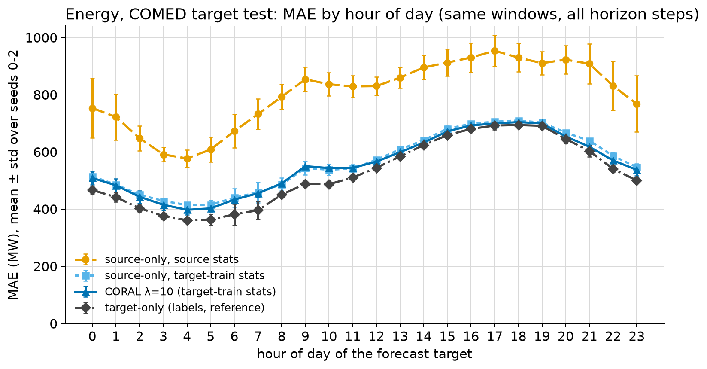
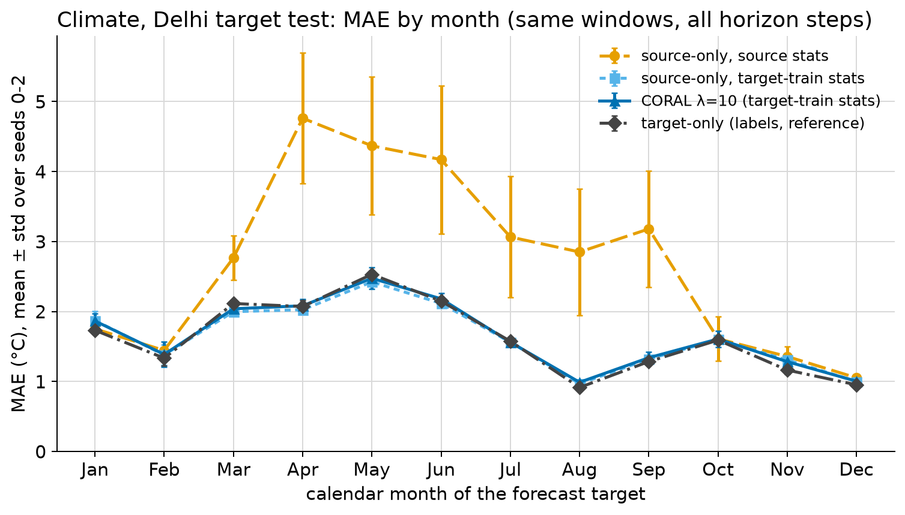

# Error structure: energy by hour of day, climate by month

Same target-test windows for every model. Errors are taken at all horizon steps (energy: 24 per window, 9,785
windows; climate: 5 per window, 610 windows), in original units, and grouped by the calendar time of the **forecast
target**. That is the hour (energy) or month (climate) of the timestamp being predicted, read from the target CSV
index. Models: seed 0, 1 and 2 checkpoints of source-only (evaluated with source stats and with target-train stats),
CORAL λ=10 and target-only. Cells are the mean ± sample std over the 3 seeds of the per-seed MAE in that group.
Produced by `results_clean/audit/audit_compute.py`; numbers in `audit_numbers.json` → `error_structure`.

"Worst-4 share" = for one seed, the squared error summed per group, the 4 largest group sums added up, divided by the
total squared error. A uniform spread would give 4/24 = 0.167 for hours and 4/12 = 0.333 for months.

## Energy (COMED, MW), by hour of day

Hour labels are the hour field of the timestamps in `data/processed/energy/comed_clean.csv`, as stored. The audit
did not re-check their time-zone convention.

| hour | n errors | source-only, source stats | source-only, target-train stats | CORAL lambda=10 | target-only (labels, reference) |
|---|---|---|---|---|---|
| 0 | 9785 | 753.4 ± 103.9 | 514.6 ± 8.5 | 509.1 ± 23.7 | 466.9 ± 13.6 |
| 1 | 9785 | 722.3 ± 80.5 | 485.7 ± 1.8 | 483.1 ± 23.9 | 441.6 ± 16.2 |
| 2 | 9785 | 647.6 ± 43.4 | 450.5 ± 2.6 | 443.1 ± 21.6 | 403.0 ± 11.6 |
| 3 | 9785 | 591.2 ± 25.2 | 428.6 ± 3.7 | 415.3 ± 20.1 | 375.8 ± 5.5 |
| 4 | 9785 | 577.3 ± 30.4 | 414.5 ± 5.8 | 397.7 ± 17.4 | 361.2 ± 5.5 |
| 5 | 9785 | 608.5 ± 43.0 | 415.6 ± 15.9 | 402.6 ± 12.3 | 363.6 ± 18.7 |
| 6 | 9785 | 672.8 ± 58.3 | 439.9 ± 32.5 | 433.6 ± 12.2 | 381.7 ± 36.7 |
| 7 | 9785 | 732.5 ± 53.7 | 458.8 ± 36.0 | 455.4 ± 13.3 | 396.1 ± 30.8 |
| 8 | 9785 | 792.9 ± 43.7 | 486.5 ± 22.2 | 490.1 ± 4.6 | 450.7 ± 9.1 |
| 9 | 9785 | 853.8 ± 42.9 | 543.9 ± 23.5 | 550.3 ± 4.2 | 488.7 ± 4.7 |
| 10 | 9785 | 836.6 ± 41.0 | 537.7 ± 19.5 | 543.6 ± 6.9 | 487.2 ± 6.2 |
| 11 | 9785 | 829.0 ± 38.4 | 542.0 ± 13.6 | 544.4 ± 9.6 | 510.6 ± 9.5 |
| 12 | 9785 | 830.1 ± 32.7 | 572.4 ± 8.3 | 566.1 ± 8.3 | 544.4 ± 8.7 |
| 13 | 9785 | 859.6 ± 36.1 | 608.8 ± 10.0 | 599.2 ± 6.0 | 584.5 ± 7.0 |
| 14 | 9785 | 895.5 ± 41.8 | 641.3 ± 11.5 | 632.5 ± 3.9 | 623.8 ± 8.9 |
| 15 | 9785 | 912.4 ± 46.8 | 681.2 ± 10.2 | 672.0 ± 4.0 | 658.6 ± 9.5 |
| 16 | 9785 | 930.1 ± 51.6 | 698.4 ± 8.1 | 692.7 ± 5.7 | 680.5 ± 9.5 |
| 17 | 9785 | 953.7 ± 53.8 | 705.9 ± 5.6 | 699.6 ± 4.0 | 692.3 ± 14.9 |
| 18 | 9785 | 929.8 ± 49.1 | 709.9 ± 4.5 | 704.3 ± 1.6 | 694.2 ± 8.2 |
| 19 | 9785 | 910.3 ± 41.0 | 702.6 ± 1.4 | 699.8 ± 3.9 | 691.2 ± 7.8 |
| 20 | 9785 | 922.7 ± 50.0 | 667.5 ± 7.4 | 654.1 ± 5.6 | 645.2 ± 15.4 |
| 21 | 9785 | 908.1 ± 69.3 | 639.3 ± 6.9 | 618.0 ± 14.3 | 603.1 ± 20.6 |
| 22 | 9785 | 830.9 ± 85.4 | 586.4 ± 10.9 | 570.5 ± 21.5 | 540.9 ± 12.0 |
| 23 | 9785 | 768.1 ± 98.0 | 546.7 ± 11.9 | 537.6 ± 20.2 | 500.4 ± 8.1 |

| method | worst-4 share of squared error, per seed (s0; s1; s2) | mean | worst 4 per seed |
|---|---|---|---|
| source-only, source stats | 0.223; 0.243; 0.223 | 0.230 | [17, 18, 19, 16]; [17, 18, 19, 20]; [17, 16, 18, 20] |
| source-only, target-train stats | 0.266; 0.264; 0.269 | 0.266 | [18, 17, 19, 16]; [18, 17, 19, 16]; [18, 19, 17, 16] |
| CORAL lambda=10 | 0.267; 0.259; 0.273 | 0.266 | [18, 19, 17, 16]; [18, 19, 17, 16]; [18, 17, 19, 16] |
| target-only (labels, reference) | 0.281; 0.284; 0.282 | 0.282 | [18, 17, 19, 16]; [18, 17, 19, 16]; [18, 17, 19, 16] |

What the table shows:
- For all four models the worst 4 hours are 16-19 (one source-stats seed has hour 20 in place of 16 or 19).
- With target-train stats, CORAL and target-only, these 4 hours carry 26-28% of the squared error, against 16.7% for
  a uniform spread.
- The source-stats model is worse at every hour, by 163-310 MW. Its worst-4 share is lower (23%): its excess over the
  target-stats model is present at all 24 hours, so the 16-19 h peak is a smaller fraction of its total.
- CORAL vs target-stats differs by at most 21 MW at any hour. The sign changes: CORAL is lower at hours 0-7 and
  12-23, and higher at hours 8-11.
- Target-only is lowest at every hour. The gap to CORAL is largest overnight and in the morning (36-62 MW at hours
  0-10) and smallest at hours 16-19 (7-12 MW).

## Climate (Delhi, °C), by calendar month

The target test runs from late January 2025 to September 2026 (the test split starts 2024-12-26; the first forecast
target is 30 days later). So January-September appear in two years and October-December in one year (see "n errors").

| month | n errors | source-only, source stats | source-only, target-train stats | CORAL lambda=10 | target-only (labels, reference) |
|---|---|---|---|---|---|
| 1 | 180 | 1.752 ± 0.037 | 1.871 ± 0.131 | 1.865 ± 0.103 | 1.732 ± 0.051 |
| 2 | 280 | 1.444 ± 0.027 | 1.380 ± 0.144 | 1.387 ± 0.178 | 1.334 ± 0.104 |
| 3 | 310 | 2.767 ± 0.313 | 1.998 ± 0.050 | 2.039 ± 0.048 | 2.114 ± 0.050 |
| 4 | 300 | 4.761 ± 0.935 | 2.026 ± 0.037 | 2.082 ± 0.093 | 2.071 ± 0.086 |
| 5 | 310 | 4.367 ± 0.986 | 2.424 ± 0.033 | 2.474 ± 0.152 | 2.531 ± 0.034 |
| 6 | 300 | 4.171 ± 1.058 | 2.116 ± 0.021 | 2.181 ± 0.085 | 2.148 ± 0.032 |
| 7 | 310 | 3.065 ± 0.865 | 1.562 ± 0.016 | 1.562 ± 0.037 | 1.575 ± 0.028 |
| 8 | 310 | 2.850 ± 0.901 | 0.969 ± 0.017 | 0.989 ± 0.034 | 0.915 ± 0.011 |
| 9 | 290 | 3.180 ± 0.833 | 1.321 ± 0.025 | 1.340 ± 0.080 | 1.285 ± 0.040 |
| 10 | 155 | 1.610 ± 0.318 | 1.599 ± 0.030 | 1.608 ± 0.115 | 1.591 ± 0.019 |
| 11 | 150 | 1.357 ± 0.139 | 1.307 ± 0.019 | 1.283 ± 0.123 | 1.163 ± 0.059 |
| 12 | 155 | 1.052 ± 0.033 | 0.999 ± 0.093 | 1.005 ± 0.041 | 0.952 ± 0.029 |

| method | worst-4 share of squared error, per seed (s0; s1; s2) | mean | worst 4 per seed |
|---|---|---|---|
| source-only, source stats | 0.690; 0.687; 0.657 | 0.678 | [4, 5, 6, 3]; [5, 4, 6, 7]; [4, 5, 6, 7] |
| source-only, target-train stats | 0.593; 0.588; 0.581 | 0.587 | [5, 3, 6, 4]; [5, 3, 6, 4]; [5, 6, 3, 4] |
| CORAL lambda=10 | 0.591; 0.620; 0.590 | 0.600 | [5, 3, 6, 4]; [5, 6, 4, 3]; [5, 3, 6, 4] |
| target-only (labels, reference) | 0.613; 0.613; 0.626 | 0.617 | [5, 3, 6, 4]; [5, 3, 6, 4]; [5, 3, 6, 4] |

The worst-4 analysis is by **month** here: 4 of 12 months, uniform share 0.333.

What the table shows:
- With target-train stats, CORAL and target-only, the worst months are March-June. They carry 58-63% of the squared
  error, and the three models differ by at most 0.15 °C in any month.
- The source-stats model is close to the others in October-February. It is 0.8-2.7 °C worse in March-September, with
  a seed std up to 1.06 °C. Its worst 4 months (April-June plus March or July) carry 66-69% of the squared error.
