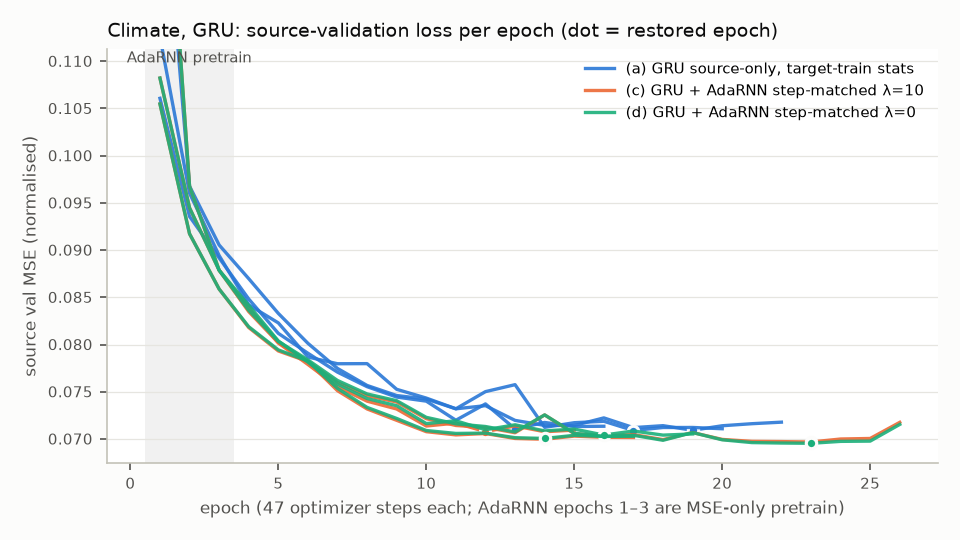

# Novelty fix: step-matched AdaRNN on climate (Shimla → Delhi), GRU

Pre-registered in CLAUDE.md Amendments 2026-11-20 (j). Target test set (610 windows, identical for all
rows), target-train-stat normalisation, MAE/RMSE in °C via `src.evaluate.evaluate_model` on `prepare_pair` windows
(the canonical.csv path). Mean ± sample std (ddof=1) over the complete seeds [0, 1, 2]. All methods: 47
optimizer steps per epoch, cap 60 (joint) epochs, early stopping on source val MSE (patience 3, min Δ 1e-5,
best weights restored); AdaRNN rows add 3 MSE-only pretrain epochs outside the cap. Generated by
`src/adarnn_fix/summarize.py`.

## Results

| row | n | MAE mean ± std | RMSE mean ± std | per-seed MAE | per-seed RMSE | best / stopped epoch per seed | source-val MSE per seed |
|---|---|---|---|---|---|---|---|
| baseline: naive train-mean (target-train stats) | – | 6.137 | 6.964 | | | | |
| baseline: persistence (last observed value repeated) | – | 1.733 | 2.350 | | | | |
| **(a) GRU source-only, target-train stats** | 3 | 1.678 ± 0.014 | 2.211 ± 0.008 | 1.667; 1.694; 1.672 | 2.204; 2.219; 2.209 | 19/22; 13/16; 17/20 | 0.07092; 0.07107; 0.07090 |
| **(b) GRU + CORAL λ=10** | 3 | 1.681 ± 0.003 | 2.216 ± 0.009 | 1.681; 1.684; 1.679 | 2.220; 2.222; 2.206 | 14/17; 14/17; 15/18 | 0.07109; 0.07018; 0.07116 |
| **(c) GRU + AdaRNN step-matched λ=10** | 3 | 1.676 ± 0.022 | 2.211 ± 0.027 | 1.695; 1.681; 1.652 | 2.234; 2.218; 2.182 | 12/15; 14/17; 23/26 | 0.07078; 0.06997; 0.06968 |
| **(d) GRU + AdaRNN step-matched λ=0** | 3 | 1.667 ± 0.016 | 2.200 ± 0.020 | 1.670; 1.681; 1.650 | 2.203; 2.218; 2.178 | 16/19; 14/17; 23/26 | 0.07042; 0.07006; 0.06954 |

Reference rows, earlier 20-epoch protocol (15 AdaRNN steps/epoch; `experiments/novelty_adarnn/climate/`):

| reference row (20-epoch cap) | n | MAE mean ± std | RMSE mean ± std | best / stopped epoch per seed |
|---|---|---|---|---|
| GRU source-only, target-train stats | 3 | 1.678 ± 0.014 | 2.211 ± 0.008 | 19/20; 13/16; 17/20 |
| GRU + CORAL λ=10 | 3 | 1.681 ± 0.003 | 2.216 ± 0.009 | 14/17; 14/17; 15/18 |
| GRU + faithful AdaRNN λ=10 | 3 | 1.792 ± 0.006 | 2.325 ± 0.007 | 20/20; 20/20; 20/20 |
| GRU + faithful AdaRNN λ=0 (grid, seed 0 only) | 1 | 1.786 | 2.318 | 20/20 |

## Noise rule (results_clean/noise_rule.md), reference R = (a)

| method vs (a) | metric | mean(M) | mean(R) | d | paired diffs (per seed) | s_R | s_M | direction | verdict |
|---|---|---|---|---|---|---|---|---|---|
| (b) GRU + CORAL λ=10 | MAE | 1.681 | 1.678 | +0.004 | +0.014; -0.009; +0.007 | 0.014 | 0.003 | higher error | within the target-stats std (exceeds method std) |
| (b) GRU + CORAL λ=10 | RMSE | 2.216 | 2.211 | +0.005 | +0.017; +0.003; -0.003 | 0.008 | 0.009 | higher error | within both |
| (c) GRU + AdaRNN step-matched λ=10 | MAE | 1.676 | 1.678 | -0.002 | +0.028; -0.013; -0.020 | 0.014 | 0.022 | lower error | within both |
| (c) GRU + AdaRNN step-matched λ=10 | RMSE | 2.211 | 2.211 | +0.000 | +0.030; -0.002; -0.028 | 0.008 | 0.027 | higher error | within both |
| (d) GRU + AdaRNN step-matched λ=0 | MAE | 1.667 | 1.678 | -0.011 | +0.002; -0.012; -0.022 | 0.014 | 0.016 | lower error | within both |
| (d) GRU + AdaRNN step-matched λ=0 | RMSE | 2.200 | 2.211 | -0.011 | -0.001; -0.001; -0.031 | 0.008 | 0.020 | lower error | exceeds the target-stats std only |

Extra (same rule, R = (d)): does the matching term add anything beyond the schedule?

| method vs (d) | metric | mean(M) | mean(R) | d | paired diffs (per seed) | s_R | s_M | direction | verdict |
|---|---|---|---|---|---|---|---|---|---|
| (c) GRU + AdaRNN step-matched λ=10 | MAE | 1.676 | 1.667 | +0.009 | +0.025; -0.000; +0.001 | 0.016 | 0.022 | higher error | within both |
| (c) GRU + AdaRNN step-matched λ=10 | RMSE | 2.211 | 2.200 | +0.011 | +0.031; -0.000; +0.003 | 0.020 | 0.027 | higher error | within both |

**Pre-registered success criterion** ((c) beats (a) under the noise rule): MAE not met, RMSE not met (counted as met only if (c) has lower error and the verdict is 'exceeds both stds').

## Not run

- nothing: all 4 methods × seeds 0-2 finished.

## What this shows

**The schedule explains the documented failure; the matching term adds nothing measurable; the pre-registered success criterion is not met.**

Step matching gives 47 steps per epoch instead of 15 and lifts the cap to 60 joint epochs. With that change, AdaRNN λ=10 falls from 1.792 to 1.676 ± 0.022 °C MAE, and the λ=0 control from 1.786 (seed 0 only) to 1.667 ± 0.016. The earlier +0.114 °C gap to the GRU source-only baseline (a) is gone. Both AdaRNN rows now beat persistence (1.733), and (c) is "within both" seed stds of (a) on MAE (−0.002) and on RMSE (+0.000). So (c) does not beat (a): it ties it. The criterion is not met under any reading of the noise rule.

The fix changed two things at once, the step count and the cap, so they are not separated cleanly. The restored epochs point mostly at the step count, though. They are 12, 14 and 23 counting the 3 pretrain epochs, which is 9, 11 and 20 joint epochs. Under the old 20-epoch cap that counted pretrain, seeds 0 and 1 would have stopped where they did here, and only seed 2 needed more. Each step-matched AdaRNN step still draws 64 windows from each of the 3 periods, so an AdaRNN epoch sees about 3× the source windows of a baseline epoch. The comparison is step-matched, not sample-matched.

**Does matching add anything beyond (d)? No.** (c) vs (d) is +0.009 °C MAE and +0.011 RMSE, "within both", with paired differences of +0.025, −0.000 and +0.001. At the restored epoch, λ·L_tdm is 0.45–0.60% of the training MSE. The validation curves of (c) and (d) lie almost on top of each other. Whatever AdaRNN gains here comes from period-balanced batches and more training, not from the distribution matching.

(d) shows lower RMSE than (a): −0.011, "exceeds the target-stats std only", driven mostly by seed 2. That falls short of "exceeds both stds", and (d) is a control, not a pre-registered method, so it is not claimed as a gain. CORAL (b) is again indistinguishable from (a).

Rows (a) and (b) are identical to the 20-epoch reference rows. Every one of those runs either early-stopped before epoch 20 or, for source-only seed 0 (best epoch 19), restores the same epoch-19 weights after stopping at 22. Training is deterministic per seed, so the cap change does not alter them.

**Not run:** nothing. All 4 methods × seeds 0–2 finished at 03:48 on 2026-11-20. No crash, no epoch over 300 s and no sleep event occurred, and no setting was changed. The runs are much faster than the earlier ones (about 1–2 s per epoch).

